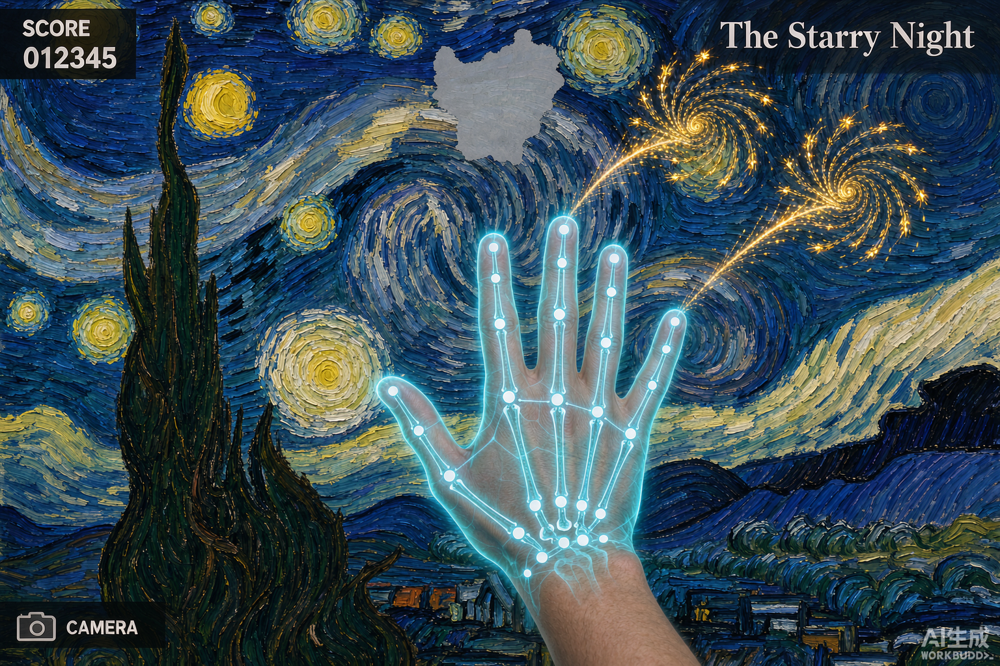

# 千里江山 · 烟花

一款用摄像头手势控制的网页互动游戏。面对摄像头伸出手，指尖即是火种——在北宋王希孟《千里江山图》的青绿山水长卷上，点亮城楼、渔舟与山巅，让沉睡千年的名画重现节庆之夜。

## 在线玩法

浏览器打开 `index.html` 即可运行（推荐 Chrome / Edge）。

> ⚠️ 摄像头需要**安全上下文**：本地直接双击打开 `file://` 在 Chrome 中可以正常调用；若部署上线需使用 HTTPS 或本地 `localhost`。

## 操作说明

### 手势模式

| 手势 | 效果 |
| --- | --- |
| 伸出食指 | 单发大烟花（指尖带火种光效） |
| 张开手掌 | 连放小烟花 |
| 握拳蓄力后松开 | 4-6 发齐放（指尖有蓄力进度环） |

**提升识别率的小技巧**：正面朝向摄像头、光线充足、避免背光；手部保持在画面中部。

### 鼠标模式

无摄像头时的兜底方案，玩法完全一致：

- 移动鼠标 = 瞄准
- 单击 = 单发烟花
- 按住左键 = 连放
- 双击 / 空格 = 齐放

快捷键：`M` 开关音效 ｜ `C` 开关摄像头预览

## 游戏规则

长卷上散布 12 处待点亮节点（山巅凉亭 ×5、城楼 ×3、渔舟 ×4）。在节点附近引爆烟花即可累积进度，进度满则点亮并获得 **+100 分**；全部点亮后触发终章全屏齐放，进入结算页查看总分与用时。

## 技术实现

- **手势识别**：MediaPipe Hands（CDN 引入，21 关键点，浏览器端运行，无需后端）
- **渲染**：Canvas 2D —— 底层为离屏预渲染的 3840px 程序化青绿山水长卷，上层为粒子层
- **粒子系统**：固定容量对象池（上限 1400），预渲染光晕精灵 + `lighter` 混合模式，避免逐帧 `shadowBlur` 开销
- **音效**：WebAudio 实时合成（升空哨音 + 爆炸低频 + 点亮风铃音），零素材文件
- **烟花形态**：牡丹 / 金菊 / 垂柳 / 环 四种爆形，红金青粉配色
- **性能**：摄像头以 320×240 低分辨率采集，手势检测节流至 30fps，渲染与识别解耦

## 课程作业版（ml5.js HandPose）

`homework-ml5/` 是同一主题的**作业实现**，按课程要求拆成三个文件、改用 `ml5.js` 的 HandPose 模型：

```
homework-ml5/
├── index.html   # 结构 + CDN 引入（ml5.js / p5.js 均带多级回退）
├── style.css    # 青绿山水配色的 HUD、按钮、摄像头小窗
└── sketch.js    # ml5.handPose 手势识别 + 烟花粒子 + 千里江山背景
```

与根目录单文件版的区别：

| | 根目录 `index.html` | `homework-ml5/` |
| --- | --- | --- |
| 手势库 | MediaPipe Hands | **ml5.js handPose** |
| 渲染 | 原生 Canvas 2D | p5.js（双层 Graphics） |
| 文件 | 单文件 | HTML / CSS / JS 三文件 |
| 音效 | WebAudio 古乐系统 | 无（作业聚焦视觉与交互） |
| 玩法 | 横向长卷滚动 | 全屏夜色山水 + 12 座山巅亭台节点 |

三个文件可直接粘进 [OpenProcessing](https://openprocessing.org) 编辑器（HTML / CSS / JS 三栏）。

## 项目结构

```
fireworks-game/
├── index.html        # 单文件游戏，包含全部逻辑
├── homework-ml5/     # 课程作业版：ml5.js + p5.js 三文件
├── README.md
├── .gitignore
└── preview/          # AI 生成的效果图
```

## 待办 Roadmap

- [ ] 关卡/难度参数调优（滚动速度、节点所需引爆次数）
- [ ] 新增《星月夜》第二关皮肤（架构支持，换数据与配色即可）
- [ ] 部署上线（GitHub Pages / Cloudflare Pages）

## 效果图

| 夜景城市场景 | 《星月夜》主题 | 《千里江山图》主题 |
| --- | --- | --- |
|  |  |  |
